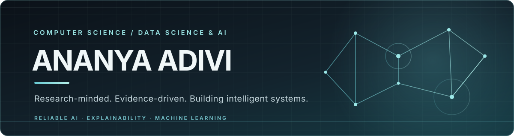

<!--
  Ananya Adivi | GitHub Profile
  Visual identity: Midnight · Ice Blue · Teal
-->

  

   

  

    

  
  &nbsp;
  

    

  

---

## 01 / About

I’m a **B.Tech Computer Science undergraduate specializing in Data Science & AI**, equally drawn to the art of understanding data and the science of building intelligent systems.

I enjoy exploring datasets, finding patterns, asking better questions, and turning analysis into meaningful insights. I’m just as interested in what happens next: developing models, evaluating their behaviour, and understanding why they make particular predictions.

My interests span **Data Science & Analytics, Machine Learning, Deep Learning, Reliable and Explainable AI, and Computer Vision**.

  DATA → INSIGHT → INTELLIGENCE

---

## 02 / Areas of interest

<table>
  <tr>
    <td width="50%" valign="top">
      <h3>Data Science & Analytics</h3>
      Exploratory data analysis · Statistical reasoning · Data visualisation · Feature engineering · Pattern discovery
    </td>
    <td width="50%" valign="top">
      <h3>Machine Learning & AI</h3>
      Predictive modelling · Deep learning · Model evaluation · Representation learning · Applied AI
    </td>
  </tr>
  <tr>
    <td width="50%" valign="top">
      <h3>Reliable & Explainable AI</h3>
      Uncertainty estimation · Model calibration · Interpretability · Trustworthy predictions
    </td>
    <td width="50%" valign="top">
      <h3>Computer Vision</h3>
      Medical imaging · Visual recognition · Image understanding · Explainable decision support
    </td>
  </tr>
</table>

---

## 03 / Projects

<table>
  <tr>
    <td valign="top" width="100%">
      <h3>Network Intrusion Detection System with Explainability</h3>
      CYBERSECURITY &nbsp;·&nbsp; MACHINE LEARNING &nbsp;·&nbsp; EXPLAINABLE AI
        
      A network intrusion detection system designed to identify malicious traffic while making model decisions easier to inspect.
        
      <strong>Technology:</strong> Python · XGBoost · Scikit-learn · SHAP · Dash · Plotly
       
      <strong>Highlight:</strong> Approximately <strong>99.8% reported attack-detection accuracy</strong>, with explainable threat analysis and an interactive monitoring dashboard.
    </td>
  </tr>
  <tr>
    <td valign="top" width="100%">
      <h3>Android Malware Detection</h3>
      FACULTY-GUIDED PROJECT &nbsp;·&nbsp; 2026 &nbsp;·&nbsp; IN PROGRESS
        
      A hybrid Android malware analysis workflow combining APK structural analysis, static and dynamic behavioural profiling, and LLM-assisted classification.
        
      <strong>Analysis:</strong> MobSF-based APK inspection, permission usage, API-call patterns, and runtime behaviour.
       
      <strong>Focus:</strong> Combining complementary evidence to support more informed malware classification.
    </td>
  </tr>
  <tr>
    <td valign="top" width="100%">
      <h3>Explainable AI for Diabetic Retinopathy Screening in Rural India</h3>
      SMART INDIA HACKATHON &nbsp;·&nbsp; SIH26038 &nbsp;·&nbsp; COMPLETED
        
      An explainable AI-based diabetic retinopathy screening system designed to support image assessment and make model predictions easier to interpret during clinical review.
        
      <strong>Dataset:</strong> APTOS, with IDRiD and Messidor considered for validation.
       
      <strong>Model:</strong> EfficientNet-B3-based five-grade classification.
       
      <strong>Explainability:</strong> Grad-CAM visual evidence to inspect model attention.
       
      <strong>Goal:</strong> Quality-aware screening and clearer referral-oriented decision support for rural workflows.
    </td>
  </tr>
</table>

---

## 04 / Tools & technologies

  

    

  <table>
    <tr>
      <td align="center"><strong>Data & analysis</strong></td>
      <td align="center"><strong>Machine learning</strong></td>
      <td align="center"><strong>Development</strong></td>
    </tr>
    <tr>
      <td align="center">NumPy · Pandas</td>
      <td align="center">Scikit-learn · PyTorch</td>
      <td align="center">Git · GitHub</td>
    </tr>
    <tr>
      <td align="center">Statistics · EDA</td>
      <td align="center">TensorFlow · SHAP</td>
      <td align="center">Flask · SQL</td>
    </tr>
    <tr>
      <td align="center">Data visualisation</td>
      <td align="center">MobSF · XGBoost</td>
      <td align="center">Dash · Plotly</td>
    </tr>
  </table>

---

## 05 / Currently exploring

- **Building:** Android malware detection through hybrid APK analysis and classification.
- **Strengthening:** Data analysis, statistics, exploratory analysis, feature engineering, and model evaluation.
- **Learning:** Reliable machine learning, explainability, and uncertainty-aware modelling.
- **Interested in:** Turning raw data into trustworthy insights and useful intelligent systems.

---

## 06 / GitHub activity

  
  &nbsp;
  

    

  

    

  

---

  <i>Curious by nature. Analytical by instinct. Always learning.</i>

    

  <a href="https://www.linkedin.com/in/ananya-adivi-9b6056345/">LinkedIn</a>
  &nbsp;·&nbsp;
  <a href="mailto:adiviananya@gmail.com">Email</a>
  &nbsp;·&nbsp;
  <a href="https://github.com/AnanyaAdivi">GitHub</a>

